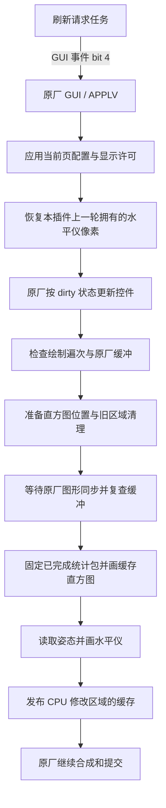

# 自定义 DISP、水平仪和直方图交接

更新于 2026-11-17。当前 L39 使用一个总开关管理四个逻辑 DISP 页，原厂绘制统一使用 DISP0，分别记忆 LCD／EVF 选择的逻辑页。沿用 L38 事务式设置恢复和非截断保存、共用前后控件、稀疏恢复、尾部绘制与提交。请求保持 16／17ms（60Hz），直方图取数开始间隔至少 120ms。只改卡模块，上游固件 edits/appends/输出摘要不变。当前组合未经实机验收。

## L39 菜单文字槽修复

用户实机反馈：进入自定义 DISP 后直接半按退出，再进设定菜单，“扩展功能”变成“DISP3 水平线”，功能入口仍正常。根因为五行首页沿用快门声音的四行文字槽 246～249，第五行写入 250，覆盖 SETUP 入口和扩展页标题共用的持久文字。正常返回可能重建文字，半按退出不会执行该返回回调。

自定义 DISP 首页、逐页选项和水平仪选择改用独立的 257～261 槽，保留入口 250、自定义 DISP 入口 253 和连拍槽 254～256；无需依赖退出时修补文字。未改状态布局、设置格式或绘制路径。宿主回归改用生产槽号（旧测试虚构起点 260，掩盖了冲突），先复现旧代码断言失败，再覆盖中英文全部页面的无 Back 退出及持久入口文字；固定 SDK 双固件交叉编译通过。仍需实机确认半按退出、重新进设置及正常返回显示。

## 当前范围

“设定菜单 → 扩展功能 → 自定义 DISP”根页有总开关和四个逻辑页。总开关开启后四页全部自定义，每页只配置“水平线（关闭／原版／TypeA）”“直方图”“详细信息”；关闭总开关恢复原厂切页，保留各页配置。

| 逻辑编号 | 对应原厂名称 | 自定义时实际基底 |
| --- | --- | --- |
| DISP0 | 详细信息 | DISP0 |
| DISP1 | 简单信息 | DISP0 |
| DISP2 | 直方图 | DISP0 |
| DISP3 | 水平线 | DISP0 |
| DISP4 | 关闭显示 | LCD 保留原厂特殊流程；EVF 按原厂行为跳过 |

LCD／EVF 共用四页偏好，但分别保存所选逻辑页。详细开时使用未修改的 DISP0 许可，关时把 DISP1 许可投影到实际 DISP0，保留基础信息和电池。不新增整屏缓存，也不逐帧整页重绘。TypeA 和直方图继续使用原来的共用尾部路径；原版水平仪仍主动准备 pose/show，关闭／TypeA 抑制四个原厂控件。

旧 D7 四页选项保留，任意一页此前启用自定义就开启新总开关；旧逐页启用位不再控制接管。旧文件没有逻辑页记忆，首次从 0 开始。新配置默认四页偏好为 `[15,1,5,17]`，分别对应详细同框、简单、直方图、原版水平仪，总开关开。

## L39：详细信息关闭后的白平衡例外

实机反馈关闭详细信息后白平衡图标仍在。组 38 的原厂六个投影源掩码为 `0x0FF1FF`，包含简单页许可；因此原有简单页投影会保留它。自定义页现在仅在详细信息关闭时清除此组实际 DISP0 的六个可见位，保留其他页位；开启详细或停用自定义后仍通过原有比较恢复机制还原。基础信息与电池不扩大隐藏范围。

两份 MAIN 静态核对组 38 descriptor `0xC1826534`、payload `0xC1826474`，横拍 LCD 矩形 `(592,2)-(660,38)`、EVF `(854,288)-(922,324)`；原厂配置函数 `0x1032D3BE` 读取模式及微调表并配置组 38。构建新增这些依赖的校验窗口，宿主测试使用真实初始掩码，覆盖四逻辑页、两输出、详细开关、比较恢复与外部改写。未运行相机 GUI，实机效果待复测。

## L39：按键接管、实际基底与页号记忆

普通拍摄 UI 对象位于 RAM `0xC18289E0`，按键回调槽 `+0x14`（`0xC18289F4`）原值为 `0x10304109`。`custom_route_sync()` 比较并安装常驻 `custom_key_dispatch()`，关闭或离开照片应用时比较恢复。不改固件指令，也不依赖 kind=8 钩子或假设键 0 是空操作；四个逻辑页不与原厂 DISP2／DISP3 专用流程混用。

1. 非 DISP、未启用或非普通照片取景时转发原回调。接管 DISP 时保留原厂 `0x10304108` 的输入前置处理和拒绝条件。
2. 调用原厂 `0x10341AAA` 一次，保留原厂可切页检查和事件标记。实际 0 被允许切换时，原厂先选到 1；实际 4 被允许切换时先选到 0。没有成功选择则不推进逻辑页、不保存。
3. 插件推进对应输出的逻辑页，在调用 GUI 前把原厂刚选中的实际页映射回 0；逻辑 4 使用原厂 LCD 关闭显示调用。这里的中间 1 只发生在按键处理里，没有在它上面调用 GUI／ISP／绘图。
4. `custom_apply()` 按逻辑页给实际 DISP0 应用显示许可，使必要快照失效。即使两页选项相同，切页仍清理／修复旧笔画和直方图；保留原厂输入后处理及 GUI 更新。
5. GUI 后立即向已有 `MENU.DAT` 保存两端逻辑页，并回读校验。不依赖关机通知，不逐帧保存。开机有效读入后、原厂生成新快照前恢复实际基底；总开关关闭时，将仍由插件持有的实际页还原为逻辑页。

`custom_route_sync()` 同时处理两个照片 DISP 属性（`0x3B15`／`0x3B16`），实际基底不变时不写设置。视频属性不使用；离开照片应用时比较交还照片属性。原厂非 DISP 行为若改变属性，例如退出关闭显示，接纳其页号并记忆，避免反复强制熄屏。按键期间原厂服务可能等待，返回后复查输出／应用／接管状态，防止通过新输出的 setter 写入旧输出的页号。

原厂快照、布局、控件、统计判断均看到稳定的实际 0，避免旧逻辑 DISP2 的原厂取数与控件配置。静态依据见 [DISP_PAGE_REPLACEMENT.md](DISP_PAGE_REPLACEMENT.md)。这移除了该干扰路径，但没有实机调用追踪证明它是直方图慢／空白／闪烁的唯一原因。

以下 L37 记录为此前保留真实页码时的历史；L39 自定义页实际为 0，不再依赖实际 DISP3 的局部接管分支。

## L37：DISP3 重启后静止原厂水平仪

实机反馈 L36：开启 DISP3 自定义，关机再开后残留静止原厂水平仪，原版、关闭和 TypeA 均可出现。静态检查发现此前 Off/TypeA 只压住主控制器，三个图像子控件仍可能带着启动时的 dirty；前置控件也要等第一次原厂页面处理器返回后才注册，不能撤销更早已写入的像素。这是本轮修复依据，尚未取得实机调用追踪，不能断言已完整定位所有残影来源。

L37 在 `disp_page(event=9)` 转发原厂之前执行 `native_level_begin()`：DISP3 自定义进入或水平仪样式变化后，对当前输出尚未处理的原厂绘图 bank 请求一次原厂快照失效（`0x103422AE`）。前置控件进入已校验的原厂遍历后，等待 GPU 并复查输出、页码、样式、bank 和 GUI 状态，再调用原厂局部清理 `0x1032C2C2`；它经 `0x104B9880` 清理原厂水平仪区域及轴线，清理后恢复模式字节。原厂控件随后按失效快照重绘，TypeA 仍在尾部画。每端最多记录四个原厂 bank，稳定状态不反复清理或整页失效；切出、重新开启或切换水平仪样式时重新开始一次接管。

关闭／TypeA 在每个前置遍历同时清四个原厂控件的 dirty 并临时隐藏，回调结束比较恢复可见性，不重新置 dirty。原版取消 DISP3 的直接跳过，和其他自定义页一样每个 APPLV 回调最多主动 pose/show 一次；禁用自定义的原厂 DISP3 保持原路径。

新增入口及局部清理依赖、相关常量均纳入双固件指纹校验。宿主测试覆盖两端三种水平仪样式、启动注册前后、四 bank 轮换、切出重入、配置改变、GPU 等待期间输出／bank／页码／开关改变，以及稳定时无重复整页失效。测试不执行原厂绘图；L37 的残影消除和原版 EVF 切换仍需实机验证。刷新保持 16／17ms 请求，直方图取数仍至少 120ms，不改固件。

## 源码入口

| 文件 | 职责 |
| --- | --- |
| [main.c](../src/card_module/main.c) | 卡模块启动、设置、菜单、保留回调及 自定义 DISP 初始化 |
| [custom_disp_install.inc](../src/card_module/custom_disp_install.inc) | 建立五行总开关／四页列表、共用三行选项页、三选一水平仪子页和持久标签 |
| [custom_disp_runtime.inc](../src/card_module/custom_disp_runtime.inc) | 设置切换、字体修复、原厂显示许可的应用与恢复 |
| [custom_disp/route.inc](../src/card_module/custom_disp/route.inc) | 常驻按键包装、逻辑页与实际页映射、两端属性接管与恢复 |
| [vui_card.inc](../src/card_module/vui_card.inc) | 原竖拍布局；LCD 直方图两阶段回调和 CPU 绘制 |
| [custom_disp/display.c](../src/card_module/custom_disp/display.c) | APPLV 页面包装、前后控件、独立取数任务和刷新请求任务 |
| [custom_disp/overlay_render.h](../src/card_module/custom_disp/overlay_render.h) | LCD/EVF 共用原厂绘制尾部检查、同步、缓存取数和叠加入口 |
| [custom_disp/native_level.h](../src/card_module/custom_disp/native_level.h) | 原版水平仪的显示、姿态更新、控件状态恢复 |
| [custom_disp/level.h](../src/card_module/custom_disp/level.h)、[smooth.h](../src/card_module/custom_disp/smooth.h)、[responsive.h](../src/card_module/custom_disp/responsive.h) | 姿态、线段、抗锯齿、遮挡合成、旧笔画恢复和缓存发布 |
| [custom_disp/histogram.h](../src/card_module/custom_disp/histogram.h)、[histogram_raster.h](../src/card_module/custom_disp/histogram_raster.h) | EVF 入口、LCD/EVF 共用的 192×96 CPU 直方图栅格 |
| [custom_disp/refresh_override.h](../src/card_module/custom_disp/refresh_override.h)、[refresh.h](../src/card_module/custom_disp/refresh.h) | 临时 k 覆盖、LCD/EVF 16／17ms 请求截止时间 |
| [build.py](../src/card_module/build.py) | 固件指纹、SDK 校验、目标头生成、编译和搬移检查 |

L20 实机反馈 EVF 水平仪和直方图已恢复显示。L21 仅在这条有效路径上做清理，尚未实机复测；该反馈不代表全部开关和页面组合均已验收。

正式模块统一命名为 `custom_disp`，目录和对外接口使用同一名称。已删除未启用的整层缓存、独立时钟提交、异步提交、额外原厂 UI 重绘和旧矩形水平仪分支；构建器只保留当前原厂 UI + 同步尾部叠加路径。旧遮挡掩码不再使用，其两份只分配不读取的 `level_stencil` 也已删除，减少 124,944 字节堆分配。稀疏像素保存区仍是现用的恢复机制，不能作为废案删除。

L21 进一步删除旧 EVF 独立取当前 bank 的绘制回退、无调用者的 `force=3` 绘后恢复分支、只写不读的 8 秒统计窗口及其状态字段、6 个废弃元数据槽位。元数据由 37 字缩为 31 字（148 → 124 字节），私有状态版本为 `0x112D000A`；当前 `R/U/C/F W/D/K/N` 诊断保留。`level_paint()` 只能使用共用尾部回调同步并复查后提供的 surface，直方图也直接使用该 surface，不再另走一次独立 EVF 初始化。恢复旧笔画仍统一在原厂绘制之前完成。EVF 的尺寸、线宽、布局位置和原厂接入条件属于有效适配，继续保留。

[overlay_state.h](../src/card_module/custom_disp/overlay_state.h) 保存两个输出的独立状态；[output.h](../src/card_module/custom_disp/output.h) 固定共同的 120ms 取数门限和支持尺寸；[sparse.h](../src/card_module/custom_disp/sparse.h) 管理共享脏行算法。原厂输出分派和 child-list wrapper 的已校验指令表明两边经过相同遍历链；descriptor 的 map/pool 常量也加入校验。L19 同步版曾将背屏专用页面对象、UI-mode 和提交 descriptor 约束套到 EVF，实机反馈 EVF 没有两项叠加。L20 恢复旧 EVF 的拍摄快照判定和原厂当前绘图 bank/尺寸接口，不要求它满足 LCD descriptor 格式；保留共同的拍摄状态、忙碌状态、输出遍次、尾节点和 GUI 锁检查。宿主测试覆盖这种接入差异，不能证明相机运行时链路或最终提交频率；L20 的恢复显示已获实机反馈，L21 清理后的精确产物待复测。

## 水平仪如何画出来

### 初始化与生命周期

`custom_disp_init()` 检查原厂函数、常量、回调和运行时对象，再把 `custom_disp_image` 代码段复制到可长期使用的堆区。LCD、EVF 分别建立前置和尾部控件，挂入各自原厂 child list；页面处理器由 `disp_page()` 包装，仍转发原厂处理器。不要在正在遍历 child list 的绘图回调里移动链表节点。

加载器在初始化返回后会释放原始模块映像。因此常驻回调只能指向已复制代码，文字、函数表和配置必须放在持久状态或显式堆区；不能把原始模块的只读字符串地址留给后续菜单。

### 请求刷新为什么在绘制之前

`disp_drive()` 沿用 L21 原厂更新位 4 唤醒 GUI，不直接在自己的任务里画图。LCD 和 EVF 共用远端 16／17ms 交替截止时间，请求目标为 60Hz；分别保存时钟，过期请求跳过，不追补积压帧。实际画图发生在原厂 GUI 线程，随后仍由原厂合成、提交。图形同步后还复查当前 DISP 页码及该页 flags，切页期间拒绝把旧配置画入新页。L21-30ms 基线只调整请求截止时间和休眠上限/空闲等待，未引入 L22–L29 的私有唤醒、独立补画或去重流程；原有绘制调度保留，L39 诊断标记用于区分逻辑页接管版本。

刷新请求是让 GUI 有机会运行的上游通知，不是显示提交，也不保证相机会以 60fps 输出。请求会合并；原厂工作、图形等待、数据供给和最终提交都可能降低实际更新频率。

### LCD/EVF 共用的更新流程（TypeA 模式；原版分支见后）

1. `disp_page()` 在调用原厂前应用自定义配置，处理离页恢复，并在有效目标页临时覆盖 k。需要时，`level_retire()` 在原厂绘图前恢复上一轮笔画，只恢复仍等于本插件上次写入值的像素；原厂已更新的像素优先。
2. 原厂页面继续按自身状态更新基本信息、详细控件、对焦提示等。前置控件也提供在原厂 child painters 前恢复旧笔画的机会，避免上一轮笔画参与原厂透明混合。
3. `overlay_native_walk_site()` 通过已校验的返回地址和栈布局识别原厂遍历。第一遍 `0x1030D8B5` 不画水平仪，第二遍 `0x1030D8DF` 允许画；条件追加的 `0x1030D8F9`、`0x1030D915` 也允许补画。**不是“每个最终显示帧绝对只画一次”**，也未劫持最终提交回调。
4. `overlay_source_paint_impl()` 确认尾部控件确实位于原厂链表末端，检查 GUI 锁、当前 bank、各输出支持的尺寸和源绑定：LCD 为 720×480，EVF 支持 720×480、1024×682/768、1280×960。LCD 额外校验其掩码 1 对应的原厂提交 descriptor；EVF 沿用当前原厂绘图 bank、尺寸及映射接口，不读取或推断掩码 4 的提交 descriptor。未知调用、离页或缓冲不符时跳过，不能继续使用历史指针强画。
5. 布局适配：LCD 调用 `vui_hist_before_level(native_bank, 0, 0, 0)` 确定横竖直方图位置，必要时通过原厂路径清除旧位置；EVF 使用已检查的原厂直方图区域。此时不取 ISP 数据。
6. `level_sync()` 等待已有图形工作完成。等待可能让出线程，所以之后再次核对有效拍摄状态、锁、bank、尺寸和映射，以及 LCD 专用的描述符，复查成功才写像素。
7. 固定当前完整统计包，由布局适配器调用同一 CPU 栅格：LCD 通过 `vui_hist_before_level(native_bank, mapped_surface, packet, dirty_rows)`，EVF 通过 `histogram_paint(packet)`。没有新数据时复用已有数据，首次成功取数前不画直方图；换 bank/尺寸/位置会触发补画。
8. 水平仪开关开启时调用 `level_paint()`，使用原厂姿态入口 `0x104B8FF0` 读取 roll/pitch 等值，按 1/8 度单位计算几何并绘制抗锯齿线段。它不是把原厂水平仪整块截屏搬过来。
9. `level_publish()` 把 CPU 修改的缓存发布给后续图形路径；LCD/EVF 都合并直方图和笔画的稀疏行范围。水平仪关闭时也发布直方图修改，两个开关互不依赖。
10. 返回原厂继续合成提交。`disp_page()` 返回前恢复临时 k，再次应用/恢复显示许可，处理注册与退出条件。

### 原版姿态／配置与切换恢复（L33 起，L36 扩展到四页）

用户反馈 L32 两端不显示，要求恢复 L30 原版接法并继续修 EVF。L33 恢复在 GUI 前置回调内调用 `0x104BA04C` 更新姿态、`0x1032C290` 配置当前输出的原厂控件；原回调 `0x104B9FEF` 负责绘制，不替换它，不另建位图缓存。LCD/EVF 共用此流程，保留 EVF 原有拍摄快照条件，不套用 LCD 页面对象／UI-mode 限制。无需先访问原厂水平仪页。

静态依据：`0x102BEE12` 遍历仅检查控件 `+0x44` dirty 即调用其 `+0x4C` 回调，没有在这里检查可见性；原厂水平仪特殊回调自身也不先检查 `+0x28`。L30 在恢复可见性时把控件重新标脏，再还原旧模式／父绑定，因而可能让下一轮使用旧输出配置绘图。这是确切的代码行为及可疑触发路径，不是已获现场证实的硬卡根因。

L33 在原厂页面回调返回、恢复旧模式和子控件绑定之前，先清除仍由本插件持有的特殊控制器 dirty；恢复可见性时不再重新标脏。每轮结束释放原版配置，下一轮按实际输出重新准备；一轮内切输出也会先释放旧配置再重建。真实且未自定义的 DISP3 接管时保留原厂新配置。L33 当时的私有记录为 60 字节，状态修订 `0x112D0014`；`cm_t` ABI 不变。

`disp_register_leading()` 在原厂处理器返回后为两个输出列表预先注册前置控件，不在遍历过程中移动节点，使首次切 EVF 时也有机会在原版特殊控件之前完成配置。尾部叠加仍只在当前输出按原流程注册／检查。若注册失败按现有拒绝流程退出，不强画。

L34 合并上游连拍任务、菜单及循环日志；连拍两个布尔开关用 `u8` 存放，使 `cm_t` 为 2748 字节、SDK 总状态恰为 4096 字节，`vui_fn` 和 `custom_disp` 偏移不变。更新后必须完全断电重启；不得热复用旧 cm_t 布局。上游机械实测仅适用于其旧产物，不算 L34 完整组合验证。

宿主测试编译实际原版准备／恢复逻辑及双前置注册辅助函数，检查两端 flags、单轮准备、输出变化、dirty-only 特殊回调在恢复后不再可运行、原厂字段变化优先、DISP3 接管、其他输出预注册和注册失败。原厂绘图、GPU 同步和真实 LCD→EVF 时序未执行；L33 尚需实机确认显示、移动、切换和退出残影，不声称 L30 硬卡已修好。

### 原版仅开放可见性（L32，历史试验）

实机反馈（2026-11-15，产物 `3d07d1f5…`）：背屏和 EVF 都没有显示，先进入当前输出的原厂水平仪页再返回详细页也无效。只开可见性试验未成功；尚未区分门控拒绝与原厂后续隐藏／清理。不得视为已支持原版详细页。

按用户要求，删除 L30/L31 的原版姿态调用、show/setup 调用、模式写入和父对象重绑定逻辑。保留原厂的四只控件及 `0x104B9FEF` 回调。新增路径仅在已校验的 GUI 前置遍历中把控件 `+0x28` 可见性从 0 改为 1，发生改变时置 `+0x44` dirty；已经可见的控件不强制 dirty。原厂自行执行遍历、绘制和提交；不会主动调用原版绘图回调，也没有原版私有像素缓存。

LCD/EVF 都可尝试，但仅接受原厂已经配置好的输出：模式字节分别为 1／3，三只子控件 `+0x48` 都必须是当前原厂输出对象；只读这些字段，绝不替原厂修正。EVF 沿用拍摄快照判断，不附加 LCD 页面对象和 UI-mode 前提。模式或绑定不符时完全跳过显示，避免借用背屏配置在 EVF 绘制。

可见性只在本轮原厂页面回调内临时开放，原厂回调返回后立即比较恢复，避免跨输出切换遗留启用状态；原厂真实 DISP3 接管时不撤销其可见性。保存记录为 40 字节，元数据仍为 32 字，私有状态修订为 `0x112D0013`，`cm_t` ABI 不变。

测试顺序：完全断电重启，选择“原版”；先在背屏进入原厂水平仪页，再回详细信息页；EVF 在其自身原厂水平仪页初始化后再回详细页。原厂 `0x1034299E` 仍只在 DISP3 更新姿态，这个限制没有绕过。因此 L32 可以验证纯可见性是否足够，但不能保证详细页上有显示或姿态持续更新，更不能宣称已修复 L30 卡死。记录首次显示、是否转动、切换是否卡住即可；未完成实机验证。

本次宿主测试编译实际权限逻辑，检查两端 32 种 flags、模式／父绑定不符不写入、无姿态／setup 服务可调用、只改可见性和 dirty、原可见控件不额外重画、比较恢复及真实 DISP3 接管；不执行原厂 GUI、GPU 或 ISP。以下 L30/L31 为历史设计与反馈。

### 原版水平仪暂停（L31）

L30 精确产物 `0a62b187…` 获用户实机反馈：背屏选择原版后开启 EVF，系统直接卡住，未提供 AE 异常码。原厂四个水平仪控件在两端共用，L30 借用了启用和绘制入口，但未证明完整切换时序安全。背屏启用状态残留、EVF 在重绑定前遍历控件是可能原因，尚无现场或调用追踪证实。

L31 将 `NATIVE_LEVEL_EXPERIMENT_ENABLED` 设为 0，在任何 GUI 查询／原厂启用之前拒绝自定义页原版绘制；同时保留禁用前的 LCD-only 门控，供后续恢复实验时审查。不能只拦 EVF 的启用入口，因为 LCD 已启用的共享控件仍可能在输出切换时被使用。菜单显示“原版暂停”，既有原版设置不强制改写为 TypeA，选择 TypeA 后 LCD/EVF 继续走此前共用路径。原厂自己的水平仪页不修改。替换后必须完全断电重启，清除 L30 常驻控件状态。

本次宿主检查验证生产开关下两端 32 种 flags 均不调用 GUI 查询、姿态或启用入口，另单独启用测试副本检查所有权恢复；不代表卡死根因已修复，也没有做新的实机验证。以下为暂停前 L30 设计记录。

### 原版水平仪模式（L30 实验）

“扩展功能 → 自定义 DISP → DISP0～DISP3 → 水平线”有关闭／原版／TypeA 三项，选择或返回时重建父页文字与标题，避免共用文字槽残留。开关与直方图、详细信息独立；不会把详细页伪装成内部 DISP3。

原版水平仪不属于 64 组常规信息许可投影，而由一只原厂回调控件（ID `0x2D7`）和三只图像控件管理。单开可见性不足：`0x1034299E` 的原厂快照更新明确只在内部 DISP3 调用姿态更新。因此当前 DISP0～DISP3 选原版时，在 GUI 前置控件、已识别的原厂遍历中，额外复用 `0x104BA04C` 更新姿态，再调用 `0x1032C290` 配置当前输出和启用原厂水平仪。每次 APPLV 页面回调最多准备一次，后续遍历沿用原厂子控件；实际绘制仍是原回调 `0x104B9FEF`，不直接手调它、不新增位图缓存、不遍历中移动节点。TypeA 的尾部 `level_paint()` 此时关闭，直方图仍沿用缓存统计路径。

当前原版恢复记录 112 字节（含四控件抑制和两端 bank 接管记录），元数据为 32 字／128 字节，状态修订为 `0x112D0018`。原版启用前保存可见性、三个输出父对象引用与原厂模式字节，离页、关闭、输出切换后比较恢复，仅恢复仍符合本插件写入值的项目；真实 DISP3 接管时不撤销原厂刚完成的设置。固件入口 `cm_t.vui_fn` 仍在 `+4`，完整大小以本次发布清单为准。

这是实机试验入口：原厂回调包含自己的区域清除、图形同步及绘制，省去 TypeA 每轮的像素保存／恢复并不能保证总耗时更少。原版没有 TypeA 的按当前 UI alpha 合成遮挡逻辑；详细控件遮挡、竖拍位置、临时 UI、LCD/EVF 切换和返回原厂水平仪页必须实机核对。宿主测试只验证设置、调用门控、单轮准备和比较恢复，不运行原厂绘图，更不能证明帧率。

### 遮挡和半透明（TypeA 模式）

物理写入发生在原厂控件绘制后，但合成效果把原厂 UI 放在水平仪上面。根据当前原厂像素的 alpha 做预乘颜色 source-over：不透明像素遮住笔画；半透明像素与笔画混合。这样不用逐个识别图标，也不依赖硬编码的详细控件矩形来遮挡水平仪。

下一轮只撤销本插件保存的笔画像素，再让原厂按 dirty 更新。原厂 UI 不会逐帧全屏强制重画，亦未新增整屏截屏/多层合成缓存。**这不等于不用堆内存**：仍有按 surface 分组的稀疏 save-under、查找表、状态和三个统计包。两边都仅发布修改过的稀疏行范围，合并后的单次缓存维护不超过 64 KiB；不再为 EVF 每次维护完整位图。每个输出独立保存最多 960 行的脏范围和刷新状态，新增的是小型元数据，不是像素缓存。

### k 和频率

原厂间隔函数 `0x1042C680` 把 k 换算成 `(k - 1) × 50ms`。本版在启用自定义的照片页转发原厂页面回调期间，把 RAM 表 `0xC18E74B0` 的 16 项首字暂设为 1，回调返回立即比较并恢复；配对字不动，原厂另行改变过的值优先。k=0 会下溢，不能用作“零间隔”。

该覆盖只去掉这一处最小时间门限，不改变传感器、图形硬件或最终扫描输出。此前观察到约 25～32 次更新不能推出固件固定锁在这个频率，当前也没有实机 60fps 的保证。

## 自定义页的显示逻辑

原厂信息不是一张保存起来的“详细页图片”，而是共享控件和显示许可。表 `0x10748504` 有 64 个组描述符；每组有 9 个掩码字，按三个场景分别描述 LCD、HDMI、EVF。掩码中的每个四位段记录该模式下的 DISP 许可。

`custom_apply()` 只修改实际 DISP0 位，按当前逻辑页的详细信息选项，从未修改的 bit0（详细）或 bit1（简单）取基底。作用于描述符字索引 `1、3、4、6、7、9`，保留 HDMI 字 `2、5、8` 和其他实际页位。组 32 的实际 DISP0 位清零，避免原厂直方图与自制图重复。

每个字保存原值与最后应用值，逐位比较交还自己持有的修改，再从原基底计算实际 DISP0；CAS 失败下轮重试。菜单／临时 UI 退出投影，回取景重用当前逻辑页。原竖拍的直方图许可副本按现有方式交还，许可变化只触发一次必要刷新，稳定时不强制重画整页。

配置与运行状态通过相邻的 `custom_flags/custom_control` 两字交给绘制模块，邻接偏移和固件入口 `vui_fn +4` 有编译断言。状态修订 `0x112D0018`，大小、SDK 容量及准确摘要以发布清单为准，更新后完全断电，不热复用旧状态。

### MENU.DAT 与字体

设置保存在 `A:\SHUTTER\MENU.DAT`，L39 保存为 16 字节：

- 前 8 字节保持原厂扩展选项格式。
- 第三字高字节为 D8，低 20 位每页仍占 5 位：保留启用位（固定 1）、TypeA、直方图、详细信息、原版。两个水平仪位冲突时原版优先；bit20／21 为机械／电子连拍关闭标记，bit22／23 必须为零。
- 第四字高 16 位为 CD50；bit0 是唯一总开关，bit4～6 为 LCD 逻辑页，bit8～10 为 EVF 逻辑页。其余位必须为零，页号只接受 0～4。运行时 ACTIVE 标记不写文件。

兼容读取旧 8 字节和 D215／D216／D7 的 12 字节格式。D7 保留四页偏好；D215／D216 只迁入 DISP0，其他页为空配置，旧版任何启用位决定新总开关。旧格式逻辑页默认 0。相机首次保存扩展已有文件，不需要重建、不新建文件；仓库交付不覆盖个人设置。旧插件不能读新 16 字节格式，回退前保留旧文件备份。

`cfg_load()` 查询精确长度、校验完整读取、magic、标签、保留位和页号，再一次性应用。失败保留 RAM；GUI 每隔至少 500ms 补读，成功停止，恢复有效配置前不能编辑。启动仅恢复，不写 MENU.DAT；接受的逻辑切页或检测到原厂页号变化时才保存页号。

`save_cfg()` 用 `0x0A` 打开已有文件，定位开头写 16 字节，关闭后重新打开，核对长度和四字内容。零写、定位、短读、回读失败有宿主检查；部分写入及物理掉电不具备原子保证，立即回读不能替代冷启动实测。

中文／英文菜单继续使用常驻标签，设置父页和水平仪子页在选择、返回时重建共用文字槽及标题。

## 直方图的性能改进

当前详细页的新路径借鉴早期 EVF 的独立取数和 CPU 批量绘制方式，再由 LCD/EVF 共用栅格。**它优化的是 GUI 工作路径和绘图调用开销；尚无同条件实机测得的加速倍数或帧率对照。** 开发中用户感到 EVF 更流畅，是选择这条路线的反馈，不能代替当前组合的性能测量。

| 项目 | 原仓库第 119 组的竖拍自制直方图 | 当前详细页/EVF 新路径 |
| --- | --- | --- |
| 数据来源 | GUI 消费原厂共享 bins/peak 缓存 | 独立任务取得完整私有统计包，GUI 固定已发布包 |
| 取数与绘图 | 原有取数由原厂负责；旧自制绘图函数本身也不读 ISP | 新增取数只在工作任务发生，GUI 不因这份插件统计而等待 ISP |
| 分箱 | 64 柱，每柱合并 4 个 bins 求平均 | 100 柱，2/3 个 bins 取最大值，总计消费 256 bins |
| 绘制 | 经过 `vui_prim()` 逐柱调用原厂 clear/rect；未变柱可跳过 | CPU 批量写 192×96 像素；LCD/EVF 都在图形同步后执行，不逐柱提交原厂图形命令 |
| 更新/修复 | 通常绘图节流 80ms，并维护上一轮柱高 | 新统计包、dirty、换 bank 或方向变化时画；相同包 150ms 修复检查 |
| CPU 缓存发布 | 原厂图形调用路径 | LCD/EVF 都与水平仪的稀疏行范围合并发布 |

旧路径在 64 柱全部非零且每柱都变化的普通增量更新里，可有 64×3（逐柱清除、背景、柱）+7（分隔线、边框）=199 次原厂图形调用。新路径同样包含逐像素工作，但没有这些逐柱的原厂 clear/rect 提交，可减少调用、钩子分派和命令组织开销；旧路径在图像很稳定、仅少数柱变化时有增量优势，新 CPU 路径收到新包会重画整个小框，因此不能声称任何场景都更快。

新路径没有把 ISP 等待搬到绘制水平仪之前：`disp_worker()` 每 20ms 检查，`disp_collect()` 的尝试开始间隔至少 120ms。接口 `0x10456B34` 可能等待传感器/ISP，失败则保留最后成功包。120ms 是调用开始门限，理想上限约 8.3 次/秒，实际受接口耗时和调度影响；不是固定每 120ms 一份新数据，也不与 60Hz 请求逐次对应。150ms 是相同包的绘图修复检查，不是另一个取数周期。

三个包每个 1,056 字节，共 3,168 字节。工作任务避开“已发布”和“GUI 正在读取”的槽；GUI 设置读者槽、执行内存屏障、复查发布序号后才使用，绘制结束再释放。不要把这改成 GUI 直接访问正在写的包，也不要为了取数即时性在 GUI 调用原厂读统计接口。

原厂在自己的路径中可能仍读取统计或等待共享图形服务；本版不消除全部原厂等待。关闭自定义的页仍保留原厂直方图与旧竖拍 64 柱路径；开启自定义的四页才统一使用新路径。

LCD 横屏直方图位置 `(476,278)`、大小 `192×96`；开启竖拍布局时详细页放在底部逻辑位置 `(144,480)`，与原水平仪页底部位置对齐。EVF 用其原厂直方图区域左上角，画 `192×96`，不照搬 LCD 像素坐标。两边挂入各自的原厂前后控件列表，但共用遍历识别、第一遍跳过、绘制前恢复、尾部检查、GPU 同步后重验和稀疏发布。原厂接入差异保留在页面有效性判定、LCD 专用 descriptor、输出尺寸、水平仪缩放及直方图位置/旋转适配；EVF 保持横版。关闭竖拍布局后 LCD 沿用横屏位置。

## 构建、发布与验证

详细操作见 [CARD_MODULE_BUILD.md](CARD_MODULE_BUILD.md)。预编译模块在 [card/Z5APP.BIN](../card/Z5APP.BIN)，摘要、代码段和 ABI 信息见 [card-module-release.json](card-module-release.json)。当前为 GCC 14.3.1 构建的 L39，大小与摘要见发布清单。状态标记为 L39L/L39E；更新插件后需完全断电重启。

`patch_data/patches.json` 只更新卡模块摘要，第 108 组固件的 edits、appends 和输出摘要不变。现有该版固件用户只需替换卡模块并完全断电重启；无需为本次卡模块再刷机。Python 生成器和 Windows 数据包都从根目录读取这份插件。

历史：L34 同步时重跑显示许可、设置、原版控件所有权／恢复、k、直方图栅格和输出同步六项宿主测试及七项打包工具测试。L35 只更改请求调度和诊断版本，重跑输出同步测试，完成双指纹构建与独立源码导出构建，其余测试沿用 L34（源码未变）。已做：ARM 构建、模块 CRC、三个保留代码段搬移与直接分支检查、ABI/SDK 容量检查、LCD/EVF 尺寸/末像素/缓存边界、共用尾部 surface 使用限制、工作任务错误与普通超时分离及 16／17ms（60Hz）计时器回绕检查、显示许可投影和恢复、旧/新设置文件、k 恢复、共享直方图栅格边界及发布数据包校验。未运行 QEMU 或 ARM 动态执行，也未把这些宿主测试当成 GUI/ISP/相机时序测试。

L39 重跑八项卡模块宿主检查，新增真实路由 C 测试，覆盖原厂输入拒绝、两端循环、GUI 前映射、切页记忆、总开关恢复、视频／冲突门控和服务等待期间输出改变；显示许可核对两份 MAIN，设置覆盖新旧格式与非法页号。双指纹 ARM 构建、CRC、保留映像／直接分支、flags/control 邻接及 SDK 容量断言通过。cm_t 为 2,752 字节（vui_fn +4、自定义指针 +2576），菜单私有堆状态 3,852 字节。七项 Windows 工具测试和实际数据包导入校验通过。未执行原厂 GUI、ISP、QEMU 或 ARM，不证明实机帧率和掉电持久性。

历史 L38 重跑七项卡模块检查（含新增的实际菜单安装／导航测试），配置测试穷举全部 1,048,576 种四页位组合，并覆盖完整读取／故障不覆盖、500ms 补读、编辑前恢复、禁止截断及回读校验；显示许可测试覆盖两份 MAIN、所有基底组合和连续切换。完成双指纹构建与独立源码导出，数据包校验见发布清单。未运行 QEMU／ARM 动态执行。

后续实机需核对当前精确产物的总开关和逐页选项组合、中文菜单、切页/换 bank 后残影、横竖拍布局、LCD/EVF 切换、半按/放大/临时调整页和待机唤醒。已有“唤醒后电池/焦距需再半按”问题未在这次解决。若测性能，要固定场景与设置对比，不能把十六进制请求数当屏幕 fps。

诊断行 `L39L` / `L39E` 分别表示最后进入拍摄页的 LCD / EVF，打开菜单后仍读取这份输出的状态，避免菜单切换输出造成误读零值。`Q` 优先报告绘图拒绝原因，其次为页面激活或注册拒绝原因（例如 02 条件不符、04 忙碌、08 临时 UI、10 描述符/尺寸、20 等待后缓冲变化、40 非尾节点、80 未识别遍历；均为十六进制）。这些是当时的拒绝状态，不能单独解释成帧率限制。`R/U/C/F` 分别是请求、原厂更新事件、自定义尾部回调、完成输出的计数率；`W/D/K/N` 为对应测量窗口的最大等待/绘制/缓存维护/原厂区间耗时，单位毫秒。`Hxxx` 是开机以来工作任务取数最大耗时（十六进制），`S4/S5/S6` 为取数中/失败/已发布。状态行长度有限，末尾字段可能被截断。各最大值可能来自不同帧，不能相加还原一帧。

## 仍需实机确认

总开关及三行逐页菜单、LCD／EVF 各自逻辑切页和完全断电记忆、LCD DISP4 的关闭／唤醒、总开关关后的原厂恢复、临时 UI／视频／回放切换、中文菜单、横竖拍布局、换 bank 后残影，以及逻辑 DISP2 的直方图柱子与闪烁。原版 EVF 硬卡尚未获新版本实机确认修复；宿主检查不执行原厂 GUI／ISP，不代表实机验收或物理 fps。
