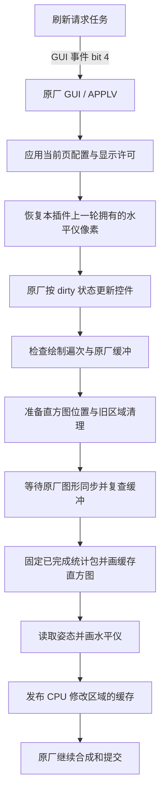

# 自定义 DISP、水平仪和直方图交接

更新于 2026-11-14。当前为 L21（在 L20 基础上清理废弃 EVF 路径）：LCD/EVF 统一绘制调度与稀疏缓存发布，直方图取数间隔至少 120ms。这次只更新卡模块，不改变第 108 组固件。该精确产物通过构建、静态检查和宿主逻辑测试，尚未完成实机验收。历史版本的实机反馈不能视为当前完整组合已通过。

## 当前范围

入口是“设定菜单 → 扩展功能 → DISP2 自定义”。它配置已有的**详细拍摄信息页**，不新增 DISP 档位。菜单名称 DISP2 是用户名称；原厂内部详细页是 `DISP0`，简单页是 `DISP1`，直方图页是 `DISP2`，水平仪页是 `DISP3`，不要混用。

| 开关 | 作用 |
| --- | --- |
| 自定义显示 | 总开关；关闭后恢复原厂显示许可，并停用此页新增叠加 |
| 水平仪 | 是否绘制自制水平仪 |
| 直方图 | 是否显示此页新增的自制直方图；关闭后独立工作任务停止这份统计的取数 |
| 详细信息 | 开：沿用原详细页；关：原厂控件的显示许可改为与简单页一致 |

四个开关默认全开。关闭详细信息保留简单页原有的基础参数、状态图标和电池；电池百分比继续服从原有“电量显示”设置。原有快门声音、网格、高光显示、竖拍触控和测试记录功能保留。

目前不能逐一配置所有 DISP 页，也没有自由拖动控件位置的功能。其他原厂直方图/水平仪页保留原有行为；其中竖拍自制直方图仍有旧绘制路径，未全部替换成新路径。视频、HDMI 不在本次自定义范围内。

## 源码入口

| 文件 | 职责 |
| --- | --- |
| [main.c](../src/card_module/main.c) | 卡模块启动、设置、菜单、保留回调及 自定义 DISP 初始化 |
| [custom_disp_install.inc](../src/card_module/custom_disp_install.inc) | 建立菜单、四个开关和持久标签 |
| [custom_disp_runtime.inc](../src/card_module/custom_disp_runtime.inc) | 设置切换、字体修复、原厂显示许可的应用与恢复 |
| [vui_card.inc](../src/card_module/vui_card.inc) | 原竖拍布局；LCD 直方图两阶段回调和 CPU 绘制 |
| [custom_disp/display.c](../src/card_module/custom_disp/display.c) | APPLV 页面包装、前后控件、独立取数任务和刷新请求任务 |
| [custom_disp/overlay_render.h](../src/card_module/custom_disp/overlay_render.h) | LCD/EVF 共用原厂绘制尾部检查、同步、缓存取数和叠加入口 |
| [custom_disp/level.h](../src/card_module/custom_disp/level.h)、[smooth.h](../src/card_module/custom_disp/smooth.h)、[responsive.h](../src/card_module/custom_disp/responsive.h) | 姿态、线段、抗锯齿、遮挡合成、旧笔画恢复和缓存发布 |
| [custom_disp/histogram.h](../src/card_module/custom_disp/histogram.h)、[histogram_raster.h](../src/card_module/custom_disp/histogram_raster.h) | EVF 入口、LCD/EVF 共用的 192×96 CPU 直方图栅格 |
| [custom_disp/refresh_override.h](../src/card_module/custom_disp/refresh_override.h)、[refresh.h](../src/card_module/custom_disp/refresh.h) | 临时 k 覆盖、LCD/EVF 60Hz 请求截止时间 |
| [build.py](../src/card_module/build.py) | 固件指纹、SDK 校验、目标头生成、编译和搬移检查 |

L20 实机反馈 EVF 水平仪和直方图已恢复显示。L21 仅在这条有效路径上做清理，尚未实机复测；该反馈不代表全部开关和页面组合均已验收。

正式模块统一命名为 `custom_disp`，目录和对外接口使用同一名称。已删除未启用的整层缓存、独立时钟提交、异步提交、额外原厂 UI 重绘和旧矩形水平仪分支；构建器只保留当前原厂 UI + 同步尾部叠加路径。旧遮挡掩码不再使用，其两份只分配不读取的 `level_stencil` 也已删除，减少 124,944 字节堆分配。稀疏像素保存区仍是现用的恢复机制，不能作为废案删除。

L21 进一步删除旧 EVF 独立取当前 bank 的绘制回退、无调用者的 `force=3` 绘后恢复分支、只写不读的 8 秒统计窗口及其状态字段、6 个废弃元数据槽位。元数据由 37 字缩为 31 字（148 → 124 字节），私有状态版本为 `0x112D000A`；当前 `R/U/C/F W/D/K/N` 诊断保留。`level_paint()` 只能使用共用尾部回调同步并复查后提供的 surface，直方图也直接使用该 surface，不再另走一次独立 EVF 初始化。恢复旧笔画仍统一在原厂绘制之前完成。EVF 的尺寸、线宽、布局位置和原厂接入条件属于有效适配，继续保留。

[overlay_state.h](../src/card_module/custom_disp/overlay_state.h) 保存两个输出的独立状态；[output.h](../src/card_module/custom_disp/output.h) 固定共同的 120ms 取数门限和支持尺寸；[sparse.h](../src/card_module/custom_disp/sparse.h) 管理共享脏行算法。原厂输出分派和 child-list wrapper 的已校验指令表明两边经过相同遍历链；descriptor 的 map/pool 常量也加入校验。L19 同步版曾将背屏专用页面对象、UI-mode 和提交 descriptor 约束套到 EVF，实机反馈 EVF 没有两项叠加。L20 恢复旧 EVF 的拍摄快照判定和原厂当前绘图 bank/尺寸接口，不要求它满足 LCD descriptor 格式；保留共同的拍摄状态、忙碌状态、输出遍次、尾节点和 GUI 锁检查。宿主测试覆盖这种接入差异，不能证明相机运行时链路或最终提交频率；L20 的恢复显示已获实机反馈，L21 清理后的精确产物待复测。

## 水平仪如何画出来

### 初始化与生命周期

`custom_disp_init()` 检查原厂函数、常量、回调和运行时对象，再把 `custom_disp_image` 代码段复制到可长期使用的堆区。LCD、EVF 分别建立前置和尾部控件，挂入各自原厂 child list；页面处理器由 `disp_page()` 包装，仍转发原厂处理器。不要在正在遍历 child list 的绘图回调里移动链表节点。

加载器在初始化返回后会释放原始模块映像。因此常驻回调只能指向已复制代码，文字、函数表和配置必须放在持久状态或显式堆区；不能把原始模块的只读字符串地址留给后续菜单。

### 请求刷新为什么在绘制之前

`disp_drive()` 只唤醒原厂 GUI，不直接在自己的任务里画图。LCD 和 EVF 共用 16/17ms 截止时间，请求目标为 60Hz；分别保存时钟，过期请求跳过，不追补积压帧。实际画图发生在原厂 GUI 线程，随后仍由原厂合成、提交。



刷新请求是让 GUI 有机会运行的上游通知，不是显示提交，也不保证相机会以 60fps 输出。请求会合并；原厂工作、图形等待、数据供给和最终提交都可能降低实际更新频率。

### LCD/EVF 共用的更新流程

1. `disp_page()` 在调用原厂前应用自定义配置，处理离页恢复，并在有效目标页临时覆盖 k。需要时，`level_retire()` 在原厂绘图前恢复上一轮笔画，只恢复仍等于本插件上次写入值的像素；原厂已更新的像素优先。
2. 原厂页面继续按自身状态更新基本信息、详细控件、对焦提示等。前置控件也提供在原厂 child painters 前恢复旧笔画的机会，避免上一轮笔画参与原厂透明混合。
3. `overlay_native_walk_site()` 通过已校验的返回地址和栈布局识别原厂遍历。第一遍 `0x1030D8B5` 不画水平仪，第二遍 `0x1030D8DF` 允许画；条件追加的 `0x1030D8F9`、`0x1030D915` 也允许补画。**不是“每个最终显示帧绝对只画一次”**，也未劫持最终提交回调。
4. `overlay_source_paint_impl()` 确认尾部控件确实位于原厂链表末端，检查 GUI 锁、当前 bank、各输出支持的尺寸和源绑定：LCD 为 720×480，EVF 支持 720×480、1024×682/768、1280×960。LCD 额外校验其掩码 1 对应的原厂提交 descriptor；EVF 沿用当前原厂绘图 bank、尺寸及映射接口，不读取或推断掩码 4 的提交 descriptor。未知调用、离页或缓冲不符时跳过，不能继续使用历史指针强画。
5. 布局适配：LCD 调用 `vui_hist_before_level(native_bank, 0, 0, 0)` 确定横竖直方图位置，必要时通过原厂路径清除旧位置；EVF 使用已检查的原厂直方图区域。此时不取 ISP 数据。
6. `level_sync()` 等待已有图形工作完成。等待可能让出线程，所以之后再次核对有效拍摄状态、锁、bank、尺寸和映射，以及 LCD 专用的描述符，复查成功才写像素。
7. 固定当前完整统计包，由布局适配器调用同一 CPU 栅格：LCD 通过 `vui_hist_before_level(native_bank, mapped_surface, packet, dirty_rows)`，EVF 通过 `histogram_paint(packet)`。没有新数据时复用已有数据，首次成功取数前不画直方图；换 bank/尺寸/位置会触发补画。
8. 水平仪开关开启时调用 `level_paint()`，使用原厂姿态入口 `0x104B8FF0` 读取 roll/pitch 等值，按 1/8 度单位计算几何并绘制抗锯齿线段。它不是把原厂水平仪整块截屏搬过来。
9. `level_publish()` 把 CPU 修改的缓存发布给后续图形路径；LCD/EVF 都合并直方图和笔画的稀疏行范围。水平仪关闭时也发布直方图修改，两个开关互不依赖。
10. 返回原厂继续合成提交。`disp_page()` 返回前恢复临时 k，再次应用/恢复显示许可，处理注册与退出条件。

### 遮挡和半透明

物理写入发生在原厂控件绘制后，但合成效果把原厂 UI 放在水平仪上面。根据当前原厂像素的 alpha 做预乘颜色 source-over：不透明像素遮住笔画；半透明像素与笔画混合。这样不用逐个识别图标，也不依赖硬编码的详细控件矩形来遮挡水平仪。

下一轮只撤销本插件保存的笔画像素，再让原厂按 dirty 更新。原厂 UI 不会逐帧全屏强制重画，亦未新增整屏截屏/多层合成缓存。**这不等于不用堆内存**：仍有按 surface 分组的稀疏 save-under、查找表、状态和三个统计包。两边都仅发布修改过的稀疏行范围，合并后的单次缓存维护不超过 64 KiB；不再为 EVF 每次维护完整位图。每个输出独立保存最多 960 行的脏范围和刷新状态，新增的是小型元数据，不是像素缓存。

### k 和频率

原厂间隔函数 `0x1042C680` 把 k 换算成 `(k - 1) × 50ms`。本版在有效详细页转发原厂页面回调期间，把 RAM 表 `0xC18E74B0` 的 16 项首字暂设为 1，回调返回立即比较并恢复；配对字不动，原厂另行改变过的值优先。k=0 会下溢，不能用作“零间隔”。

该覆盖只去掉这一处最小时间门限，不改变传感器、图形硬件或最终扫描输出。此前观察到约 25～32 次更新不能推出固件固定锁在这个频率，当前也没有实机 60fps 的保证。

## 自定义页的显示逻辑

原厂信息不是一张保存起来的“详细页图片”，而是共享控件和显示许可。表 `0x10748504` 有 64 个组描述符；每组有 9 个掩码字，按三个场景分别描述 LCD、HDMI、EVF。掩码中的每个四位段记录该模式下的 DISP 许可。

`custom_apply()` 只在照片详细页、普通取景 UI、有自定义总开关且“详细信息：关”时，把简单页 bit1 投影到详细页 bit0。每个模式段都处理：

```c
simple = (value & ~0x111111u) | ((value >> 1u) & 0x111111u);
```

作用于描述符字索引 `1、3、4、6、7、9`，保留 HDMI 字 `2、5、8` 及其他 DISP 位。效果是：两页都有的保留，仅详细页有的隐藏，仅简单页有的允许按原厂条件显示。没有真的切换到简单页；原来的详细页控制器和自制叠加回调继续工作。

每个改动先保存原值，使用 CAS 改写。重新开启详细信息、关闭总开关、进入菜单/临时页面或离开目标页时，只有当前值仍等于本插件写入值才恢复，避免覆盖原厂新值。显示许可变化后走原厂失效刷新，并丢弃旧图标绘制调用记录，防止竖拍修复把隐藏项目补回来；这清掉的是调用元数据，不是整屏画面。关闭详细信息期间也禁止竖拍模块强行打开焦距控件。

可见性状态含 384 个保存字和 12 个 ownership 字，加菜单文字等共 1,868 字节。`cm_t` 仍为 2,716 字节；固件读取的竖拍入口在 `+4`，自定义 DISP 指针在 `+2576`。当前 SDK 持久块连同已有音频分配预算使用 4,064 / 4,096 字节，后续加字段必须重新核对，不能盲目扩展。

### MENU.DAT 与字体

设置保存在 `A:\SHUTTER\MENU.DAT`。前 8 字节沿用原格式：magic `0x4D53355A` 和原有开关/声音参数；第三个 32 位字是 `0xD2150000 | flags`。低四位依次为总开关、水平仪、直方图、详细信息。

旧 8 字节文件或无效扩展标签默认四项全开；保存后写为 12 字节，不改变原有设置位。相机新建文件的可靠性问题沿用原实现，因此继续保留卡上已有设置文件，不要求用户删除重建。

原厂 UTF-16 文字设置接口会改运行时字体字节。写完自定义中文标签和每个菜单行后，需要恢复 `RUNTIME_STYLE = HANS_FONT`（字体 2），否则进入子页会出现方框乱码。菜单复用声音子页的行槽，返回声音菜单时必须刷新原来的标签。

## 直方图的性能改进

当前详细页的新路径借鉴早期 EVF 的独立取数和 CPU 批量绘制方式，再由 LCD/EVF 共用栅格。**它优化的是 GUI 工作路径和绘图调用开销；尚无同条件实机测得的加速倍数或帧率对照。** 开发中用户感到 EVF 更流畅，是选择这条路线的反馈，不能代替当前组合的性能测量。

| 项目 | 原仓库第 119 组的竖拍自制直方图 | 当前详细页/EVF 新路径 |
| --- | --- | --- |
| 数据来源 | GUI 消费原厂共享 bins/peak 缓存 | 独立任务取得完整私有统计包，GUI 固定已发布包 |
| 取数与绘图 | 原有取数由原厂负责；旧自制绘图函数本身也不读 ISP | 新增取数只在工作任务发生，GUI 不因这份插件统计而等待 ISP |
| 分箱 | 64 柱，每柱合并 4 个 bins 求平均 | 100 柱，2/3 个 bins 取最大值，总计消费 256 bins |
| 绘制 | 经过 `vui_prim()` 逐柱调用原厂 clear/rect；未变柱可跳过 | CPU 批量写 192×96 像素；LCD/EVF 都在图形同步后执行，不逐柱提交原厂图形命令 |
| 更新/修复 | 通常绘图节流 80ms，并维护上一轮柱高 | 新统计包、dirty、换 bank 或方向变化时画；相同包 150ms 修复检查 |
| CPU 缓存发布 | 原厂图形调用路径 | LCD/EVF 都与水平仪的稀疏行范围合并发布 |

旧路径在 64 柱全部非零且每柱都变化的普通增量更新里，可有 64×3（逐柱清除、背景、柱）+7（分隔线、边框）=199 次原厂图形调用。新路径同样包含逐像素工作，但没有这些逐柱的原厂 clear/rect 提交，可减少调用、钩子分派和命令组织开销；旧路径在图像很稳定、仅少数柱变化时有增量优势，新 CPU 路径收到新包会重画整个小框，因此不能声称任何场景都更快。

新路径没有把 ISP 等待搬到绘制水平仪之前：`disp_worker()` 每 20ms 检查，`disp_collect()` 的尝试开始间隔至少 120ms。接口 `0x10456B34` 可能等待传感器/ISP，失败则保留最后成功包。120ms 是调用开始门限，理想上限约 8.3 次/秒，实际受接口耗时和调度影响；不是固定每 120ms 一份新数据，更不是 60Hz 统计。150ms 是相同包的绘图修复检查，不是另一个取数周期。

三个包每个 1,056 字节，共 3,168 字节。工作任务避开“已发布”和“GUI 正在读取”的槽；GUI 设置读者槽、执行内存屏障、复查发布序号后才使用，绘制结束再释放。不要把这改成 GUI 直接访问正在写的包，也不要为了取数即时性在 GUI 调用原厂读统计接口。

原厂在自己的路径中可能仍读取统计或等待共享图形服务；本版不消除全部原厂等待。原厂直方图页、水平仪页的横屏原厂直方图未换成新实现，竖拍这些页也保留旧 64 柱函数。性能说明专指新详细页/EVF 路径。

LCD 横屏直方图位置 `(476,278)`、大小 `192×96`；开启竖拍布局时详细页放在底部逻辑位置 `(144,480)`，与原水平仪页底部位置对齐。EVF 用其原厂直方图区域左上角，画 `192×96`，不照搬 LCD 像素坐标。两边挂入各自的原厂前后控件列表，但共用遍历识别、第一遍跳过、绘制前恢复、尾部检查、GPU 同步后重验和稀疏发布。原厂接入差异保留在页面有效性判定、LCD 专用 descriptor、输出尺寸、水平仪缩放及直方图位置/旋转适配；EVF 保持横版。关闭竖拍布局后 LCD 沿用横屏位置。

## 构建、发布与验证

详细操作见 [CARD_MODULE_BUILD.md](CARD_MODULE_BUILD.md)。预编译模块在 [card/Z5APP.BIN](../card/Z5APP.BIN)，摘要、代码段和 ABI 信息见 [card-module-release.json](card-module-release.json)。当前为 GCC 14.3.1 构建的 L21 EVF 清理版：62,068 字节，SHA-256 `84559a1f55156b13bbf918bc329870f8b41e1b8ecb1ed5d608f3e2180a0e6318`。状态标记为 L21L/L21E；更新插件后需完全断电重启。

`patch_data/patches.json` 只更新卡模块摘要，第 108 组固件的 edits、appends 和输出摘要不变。现有该版固件用户只需替换卡模块并完全断电重启；无需为本次卡模块再刷机。Python 生成器和 Windows 数据包都从根目录读取这份插件。

已做：ARM 构建、模块 CRC、三个保留代码段搬移与直接分支检查、ABI/SDK 容量检查、LCD/EVF 尺寸/末像素/缓存边界、共用尾部 surface 使用限制、工作任务错误与普通超时分离及 60Hz 计时器回绕检查、显示许可投影和恢复、旧/新设置文件、k 恢复、共享直方图栅格边界及发布数据包校验。未运行 QEMU 或 ARM 动态执行，也未把这些宿主测试当成 GUI/ISP/相机时序测试。

后续实机需核对当前精确产物的四个开关组合、中文菜单、切页/换 bank 后残影、横竖拍布局、LCD/EVF 切换、半按/放大/临时调整页和待机唤醒。已有“唤醒后电池/焦距需再半按”问题未在这次解决。若测性能，要固定场景与设置对比，不能把十六进制请求数当屏幕 fps。

诊断行 `L21L` / `L21E` 分别表示最后进入拍摄页的 LCD / EVF，打开菜单后仍读取这份输出的状态，避免菜单切换输出造成误读零值。`Q` 优先报告绘图拒绝原因，其次为页面激活或注册拒绝原因（例如 02 条件不符、04 忙碌、08 临时 UI、10 描述符/尺寸、20 等待后缓冲变化、40 非尾节点、80 未识别遍历；均为十六进制）。这些是当时的拒绝状态，不能单独解释成帧率限制。`R/U/C/F` 分别是请求、原厂更新事件、自定义尾部回调、完成输出的计数率；`W/D/K/N` 为对应测量窗口的最大等待/绘制/缓存维护/原厂区间耗时，单位毫秒。`Hxxx` 是开机以来工作任务取数最大耗时（十六进制），`S4/S5/S6` 为取数中/失败/已发布。状态行长度有限，末尾字段可能被截断。各最大值可能来自不同帧，不能相加还原一帧。

## 后续全 DISP 自定义的边界

共享控件掩码支持把详细页许可投影到别的 DISP 位，因此可以发展成每页单独选择简单/详细信息，再叠加水平仪和直方图。还需要把 `Z5_CUSTOM_DISP_TARGET_DISP`、`custom_apply()`、竖拍直方图的固定页码等判断改成按页配置，处理原厂自带水平仪/直方图的冲突、离页恢复和设置格式升级。

目前这些没有实现，也不应只把四个页码都改成 0 来模拟：那会丢失切页身份。先保留每个原厂 DISP 槽的身份，再按槽配置显示许可和叠加，仍可复用原厂绘制而不增加每页图像缓存。
