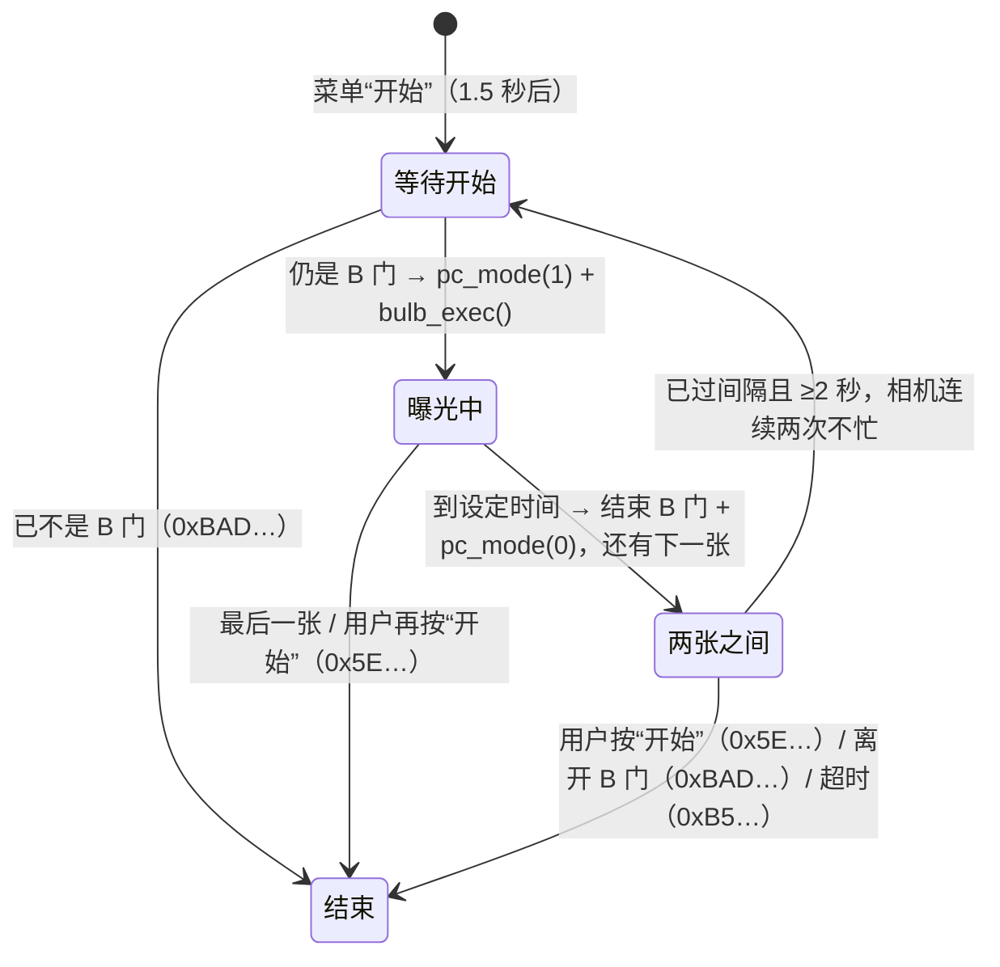

# B 门定时与间隔曝光是怎么实现的

适用：尼康 Z 5，固件 C 1.50，卡上模块（`src/card_module`）。本文的地址都是 C 1.50 MAIN 模块里的地址。

**一句话**：Z 5 原厂没有长于 30 秒的快门，也没有机内 B 门定时。我们不改快门表。模块**在相机内部调用尼康给电脑遥控拍摄用的那套 B 门开始 / 结束流程**：先切到“电脑控制”状态，开 B 门，计时，结束 B 门，再切回来。间隔曝光就是把这一次完整的流程按张数重复，每两张之间等相机空闲。**这项功能不需要改固件**，全部在卡上模块里。

用法见 README：照片拍摄菜单 → B门定时，设好时、分、秒、张数、间隔后按“开始”，约 1.5 秒后开始曝光。只在曝光模式为 B 门（Bulb）时可用。

## 1. 为什么不能直接放开 30 秒限制

最早的想法是照搬 Z30 的 M900（M 档最长 900 秒）。Z30 的做法是把设置 `0x11A3` 读成“开”。在 Z 5 上逐步排除了这条路：

| 测试 | 做法 | 相机上的结果 |
|---|---|---|
| A7 | 固件里把设置 `0x11A3` 读成 1（同 Z30） | 无效果，M 档仍然最长 30 秒。静态分析发现 Z 5 的 `0x11A3` 是和 `0x11A2` 成对的三态设置，不是“扩展快门”开关 |
| A8 | 读出快门设置 | 快门值是设置 `0x0205`，单位 1/24 EV（30 秒 = -120，1/8000 = 312）；快门方式是 `0x020E`：0 普通、2 B 门、3 遥控 T 门 |
| A8 | 查表 | 曝光侧的 Tv 查找表 `0x115779C8` 和逐档标志表 `0x115BAEE4` 都**从 -120（30 秒）开始**，没有更慢的档位。强行放宽转盘下限会让这些查表读到表外，不安全 |
| A10 | 强制 60 秒 | 无效果 |

结论：Z 5 C 1.50 的快门链路里根本没有 30 秒以上的档位。路线改为：**用 B 门，由模块决定什么时候结束。**

## 2. 找到能“结束曝光”的入口

B 门曝光的结束平时来自松开快门按钮。模块需要一个软件能调用的结束入口。

**按钮路径（A9、A11，没走通）**：读出 B 门 / T 门曝光结束时的事件顺序，结束时 CAPSEQ 收到事件 `0x10` / `0x20`，但没找到可以安全投递它的地方。A11 试过 USB 的结束函数 `0x1021A32C`，对按钮开始的曝光不起作用，因为它只认 USB 拍摄状态 `0xC18A84E4 = 2`，而按钮开始的曝光不会进入这个状态（记录 09：状态一直是 0）。

**USB 遥控路径（走通）**：相机通过 USB 支持遥控 B 门。2026-11-16 在电脑上用 `research/m900/wpd_cmd.py` 发送 PTP 命令实测：

| 步骤 | PTP 命令 | 相机回应 |
|---|---|---|
| 切到电脑控制 | `0x90C2(1)` ChangeCameraMode | `0x2001` OK |
| 开始 B 门 | `0x9207(0xFFFFFFFF, 0)` InitiateCaptureRecInMedia | `0x2001`；随后 10 秒内 DeviceReady 返回 `0xA200`（快门开着） |
| 结束 | `0x920C(0, 0)` TerminateCapture，10.1 秒后发送 | `0x2001`，得到约 10 秒的照片 |
| 切回 | `0x90C2(0)` | OK |

（在 T 门方式下，`0x9207` 会被拒绝，返回 `0xA004`。）

于是目标变成：**在相机内部、没有 USB 连接的情况下，走同一条遥控拍摄流程。**

## 3. 把 USB 遥控流程搬进模块

PTP 命令表在 `0x116A63A0` 附近，每个命令有检查函数和执行函数。模块逐个复刻了执行函数做的事，只是不发 USB 回应：

| 步骤 | 原厂位置 | 模块里的函数（`burst_speed.inc`） |
|---|---|---|
| 切到电脑控制 | `0x90C2` 执行函数 `0x103564FA`：比较属性 `0x2400`，发请求 `0x040F0007 {mode, 0, 0x103564C3}`，等标志 `0x20000`，再轮询属性 `0x1B0C == 1` | `pc_mode(1)` |
| 开始 B 门 | `0x9207` 执行函数 `0x10317724`：`0x10317622` 用请求填好拍摄结构 `0xC29C46D8`，`0x103565C0(1)`、`0x1030872E`，然后真正开始：`0x10219DDE(0xC29C46D8, [0xC18CA1CC])`（发 CSCS 请求 `0x46`），再把结果换成 PTP 码 `0x1031752A` | `bulb_exec()`：伪造一个 `0x9207` 请求，参数 `0xFFFFFFFF, 0`，按同样顺序调用 |
| 结束 B 门 | `0x920C` → `0x1021A32C(&0)`（只在 USB 拍摄状态为 2 时生效） | `BT_END` |
| 切回 | 同上，模式 0 | `pc_mode(0)` |

缺一步都不行。下面的数据来自本地读卡（`Z5LOG/DIAGnn.BIN` 偏移 `0xDC0` 的 `TB12` 记录），每个测试都是“开始 → 计时 10 秒 → 结束”：

| 测试 | 少了什么 | `TB12` 记录（开始结果 / 0.5 秒后的 USB 拍摄状态） | 结果 |
|---|---|---|---|
| A12（DIAG14） | 没切电脑控制，也没填拍摄结构 | `0x00000001` / `0x100`（状态 0） | 没有曝光 |
| A13（DIAG16） | 切了电脑控制，没填拍摄结构 | `0x00000001` / `0x100`（状态 0）；屏幕出现“已连接到电脑” | 没有曝光 |
| **A14（DIAG18）** | 完整流程 | **`0x20010000`**（PTP `0x2001` 成功）/ **`0x102`（状态 2，快门开着）** | **照片 DSC_1254，9.9 秒** |
| A18（DIAG01） | 完整流程，从菜单启动 | `0x20010000` / `0x102` | DSC_1258、DSC_1259，9.9 秒 |

A14 的完整记录（12 个字，小端）：

```
TB12  phase=3  start=23573 ms  start=0x20010000  end=0  after500ms=0x102/0x100  end_at=33598 ms  after1s=0x100
```

开始到结束 33598 − 23573 = 10025 毫秒，照片 EXIF 写的是 99/10 = 9.9 秒。

**超过 30 秒**（A15）：同一流程，计时改成 60 秒和 300 秒：

| 照片 | EXIF 曝光时间 | 光圈 / ISO | 拍摄时间 |
|---|---|---|---|
| DSC_1254（A14） | 99/10 = 9.9 s | f/22 / ISO 100 | 2026-11-16 21:30:30 |
| DSC_1255（A15） | 599/10 = 59.9 s | f/22 / ISO 100 | 2026-11-16 21:37:02 |
| DSC_1256（A15） | 3001/10 = 300.1 s | f/22 / ISO 100 | 2026-11-16 21:40:19 |
| DSC_1258（A18） | 99/10 = 9.9 s | f/22 / ISO 100 | 2026-11-16 23:21:09 |
| DSC_1259（A18） | 99/10 = 9.9 s | f/22 / ISO 100 | 2026-11-16 23:21:34 |

快门开过了原厂的 30 秒上限，并且按时结束。这些数字由 `Z5LOG` 文件和照片 EXIF 直接解出，照片和记录文件保存在作者本地，不放进仓库。

## 4. 菜单和“开始”之后发生了什么

**菜单**（A16，A55 扩展）：在照片拍摄菜单（页 `0x46`）末尾加一行“B门定时：h:mm:ss”（槽 257，行号 `0x2FC0`），进去是 6 行：开始、时、分、秒、张数、间隔（槽 258–263，行号 `0x2FC1`–`0x2FC6`）。右键或 OK 加一，左键减一；拍摄进行中这些值不能改。设置存进卡上的 `SHUTTER/MENU.DAT`：时分秒在第 3 字，张数和间隔在第 1 字的 bit 11–15 / 19–23。

**按下“开始”后怎么离开菜单**：
- A17 在 OK 的处理函数里直接发“关闭菜单”消息，结果黑屏、需要重启（菜单路由还没走完就被关掉）。**以后不要这样做。**
- A18 起改为模拟半按快门：0.2 秒后，模块的任务线程通过相机自己的按键输入（`0x101ED79E` 读当前按键状态，`0x101ED678` 提交）把第 0 组 bit 31（半按）置 1，0.3 秒后松开。相机把它当成真的半按，自然退出菜单。
- A19 把“开始”到曝光的延迟从 6 秒缩短到 1.5 秒（`BT_DELAY_MS`）。

**计时**：模块任务每 50 毫秒执行一次 `bulb_step()`。它是一个小状态机，状态存在 `q[1]`：



曝光中再按一次“开始”会提前结束这一张，并结束整组。

## 5. 间隔曝光（A55）

每一张都是第 3 节那次完整的单张流程（切电脑控制 → 开始 → 计时 → 结束 → 切回），没有新的固件调用。新增的是**两张之间的等待**（状态 4），下面几项**全部**满足才开下一张：

1. 离上一张结束已过设定的间隔，并且至少 2 秒（`BT_GAP_MIN_MS`）；
2. 属性 `0x1B17` 为 0：这是 USB `0x9207` 检查函数 `0x103173F6` 用来回答 `0x2019 DeviceBusy` 的那一项（长时间曝光降噪、写卡时相机忙）。我们的流程跳过了 USB 检查函数，所以模块自己问一次；
3. 曝光标志字 `0xC18A7EE4` 为 0：读卡发现它在快门开着时为 1（A9：从 0 → 1 到 1 → 0，正好覆盖一次曝光）；
4. 第 2、3 项要连续两次轮询（每 50 毫秒一次）都成立。

如果等了“曝光时间 + 间隔 + 120 秒”相机仍然忙，就结束整组，避免无限等待。

可选值由公式算出，不用查表（每项 5 位，存进 `MENU.DAT`）：

| 项目 | 可选值 |
|---|---|
| 张数 | 1–10，15–50 每 5，60–100 每 10，200–900 每 100，999 |
| 间隔（秒） | 0–10，15–60 每 5，90–300 每 30，600，900，1800 |
| 单张曝光 | 时 0–23，分 0–59，秒 0–59（首次默认 1 分钟） |

“间隔”是上一张结束到下一张开始的时间，不是两张开始之间的时间。

## 6. 记录与测试

**相机上的记录**：每次“保存测试记录”都会写出 `Z5LOG/DIAGnn.BIN`：
- `0xDC0`：`TB12`，当前这一张：阶段、开始时间、开始结果、结束结果、0.5 秒和结束 1 秒后的 USB 拍摄状态 / 曝光标志；
- `0x36400`：`TBS1`，整组：设定张数、已完成张数、间隔、曝光、最近一次忙碌位、最近一次已等待毫秒、结束原因；从 `+0x40` 起每张 16 字节（开始字、开始毫秒、结束毫秒、开拍前等了多久）。

**电脑上的测试**：`tests/card_module/verify_bulb_series.py` 把真正的 `bulb_step()` 源码抽出来，用桩函数代替固件调用，在电脑上编译运行。检查项：单张行为不变；张数和每张曝光准确；每张前后都切换电脑控制；不会在间隔未到、不足 2 秒或相机忙时开拍；间隔中、曝光中、开始瞬间按 OK 都能结束；离开 B 门会结束；相机一直忙会超时结束；999 张；步进表和文字。当前结果：

```
PASS: real bulb_step with the A55 series: one shot unchanged; set shot count and exposure; switch on/off around
every shot; interval, 2 s minimum and busy camera waited for; OK in the interval, an exposure or the start instant
ends it; Bulb left ends it; never-ready timeout; 999 shots; step tables and texts
```

**实机状态**：

| 内容 | 状态 |
|---|---|
| 单张 10 秒 / 60 秒 / 300 秒（A14、A15） | 实机验证，有照片 EXIF 和 `TB12` 记录（见上表） |
| 菜单、半按离开菜单、1.5 秒后开始（A18、A19） | 实机验证 |
| 张数和间隔（A55） | 作者上机测试后反馈“一切正常”；`TBS1` 记录没有读回，没有逐张数据 |
| 900 秒以上的单张 | 没有专门测试 |
| 长时间曝光降噪期间 `0x1B17` 是否真的为“忙” | 没有专门的读数；若不为忙，仍有 2 秒最短间隔和开始时返回的 PTP 码兜底 |

## 7. 试过但放弃的

- **日期样式的时分秒选择框**（A20、A21）：仿原厂“日期和时间”页，上下键正常，但左右切换格子时相机立即死机（模拟器里不死机），用户决定搁置。
- **测光建议时间**（A22–A25）：找到了拍摄时的 AE 结果，但在 B 门下建议值总是“不到 1 秒”，搁置。

## 相关文件

| 文件 | 内容 |
|---|---|
| `src/card_module/burst_speed.inc` | `pc_mode`、`bulb_exec`、`bt_half`、`bulb_step`、菜单页 |
| `src/card_module/main.c` | 编译开关（`BULB_PCMODE`、`BULB_FULLEXEC`、`BT_HALF_PRESS`、`BT_DELAY_MS 1500`）、`bt_t` 结构 |
| `tests/card_module/verify_bulb_series.py` | 间隔曝光的电脑端测试 |

本项目与尼康公司无关。B 门定时只在作者的一台 Z 5 上测试过；刷入修改固件有损坏相机的风险。
